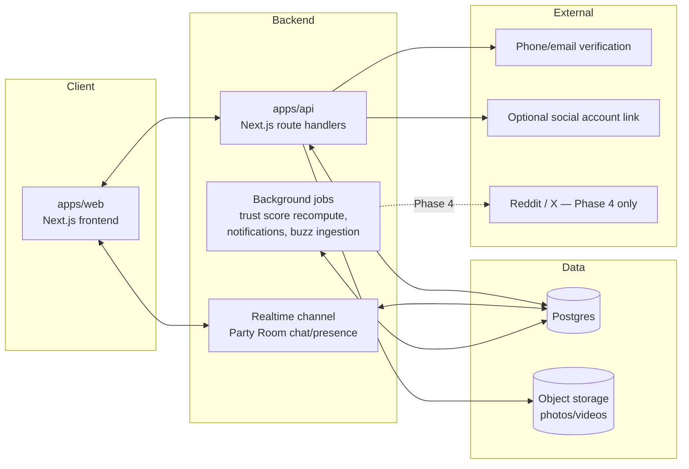
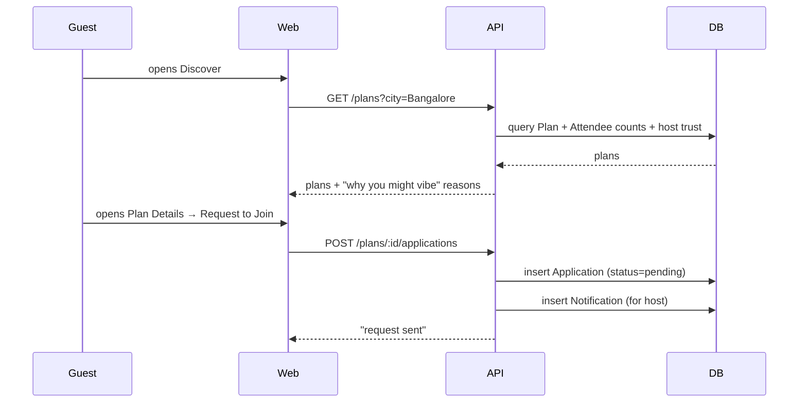
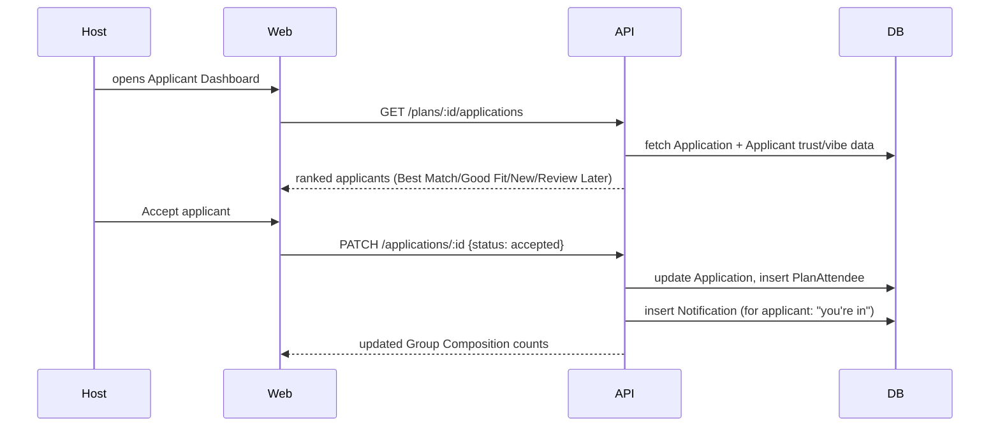
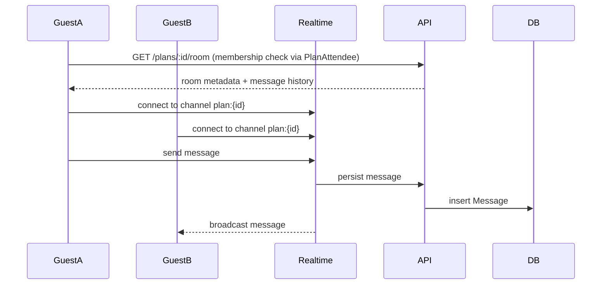
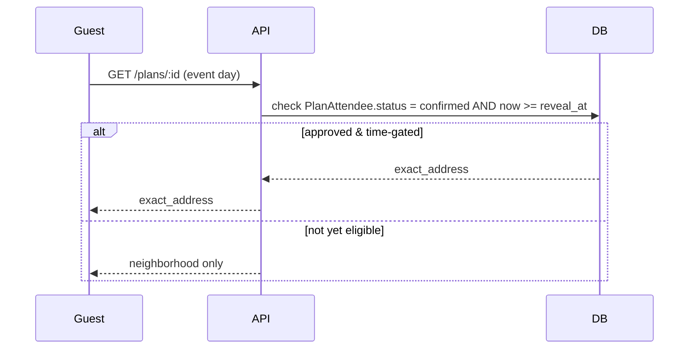
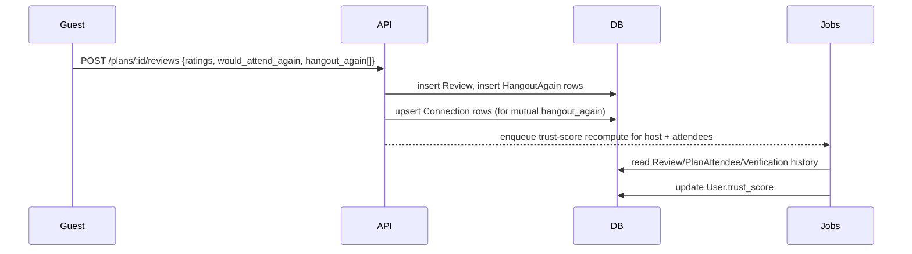
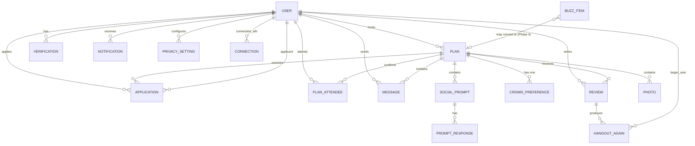

# Baithak — Architecture & Data Model

Companion to [`docs/PRODUCT_PLAN.md`](PRODUCT_PLAN.md). This doc answers "what are the moving parts and how does data flow between them" — meant to be sketched on a whiteboard (tldraw) before any schema/code is written. Nothing here is implemented yet.

## 1. System overview

**Why this shape:**
- `apps/web` and `apps/api` are separate deployable apps (see `CLAUDE.md`) — all data crosses that boundary over HTTP, never a direct import.
- A **realtime channel** is called out separately from the main API because Party Room chat (Screen 16) needs live delivery — a plain request/response API can't do that. This can be a hosted pub/sub (e.g. Ably/Pusher) or a WebSocket server; the schema doesn't care which, it just needs `Message` rows persisted somewhere both paths can write to.
- **Background jobs** exist because two things in the product plan are explicitly *not* synchronous: trust-score recomputation (accrues from history, doesn't need to be instant) and Buzz ingestion (a scraper, Phase 4, deferred per `PRODUCT_PLAN.md` §5).
- Object storage is separate from Postgres — photos/videos (Screens 08, 20) are blobs, not rows; Postgres holds the `Photo` metadata row pointing at the blob URL.

## 2. Core data flows

Each flow below is a slice of the core loop from `PRODUCT_PLAN.md` §1, drawn as a sequence so you can lay out the same actors as swimlanes in tldraw.

### 2.1 Discover → Request to Join

### 2.2 Host reviews & accepts

### 2.3 Party Room chat (before the event)

### 2.4 Event day address reveal

This is the concrete mechanism behind the safety principle in `PRODUCT_PLAN.md` §4: `Plan.exact_address` is a column that only ever leaves the API for attendees whose `PlanAttendee.status = confirmed`, gated additionally by a reveal time the host sets (e.g. 24h before, or "always after acceptance" — an open decision, see §7 below).

### 2.5 Post-event → reputation loop

## 3. Entity-relationship diagram

## 4. Table-by-table schema reference

Types are written Postgres-flavored; treat as a plain reference for redrawing boxes/fields in tldraw, not a migration file.

### `user`
| column | type | notes |
|---|---|---|
| id | uuid, pk | |
| name | text | |
| age | int | |
| city | text | e.g. "Bangalore" |
| bio | text | nullable |
| avatar_url | text | nullable |
| phone | text | unique, nullable until verified |
| email | text | unique, nullable |
| trust_score | numeric | recomputed by background job, not written directly by API requests |
| created_at | timestamptz | |

### `verification`
| column | type | notes |
|---|---|---|
| id | uuid, pk | |
| user_id | uuid, fk → user | |
| type | enum(phone, email, social) | |
| provider | text | nullable, e.g. "instagram" for social |
| verified_at | timestamptz | |

### `plan`
| column | type | notes |
|---|---|---|
| id | uuid, pk | |
| host_id | uuid, fk → user | |
| title | text | |
| category | enum(house_party, drinks, dinner, game_night, movie, sports, trip, other) | |
| vibe_tags | text[] | e.g. {bollywood, drinks, dancing} |
| neighborhood | text | **public** field, e.g. "HSR Layout" |
| exact_address | text | **never returned publicly** — see flow 2.4 |
| starts_at | timestamptz | |
| capacity | int | |
| status | enum(draft, open, full, completed, cancelled) | |
| created_at | timestamptz | |

### `crowd_preference`
| column | type | notes |
|---|---|---|
| plan_id | uuid, pk/fk → plan | one row per plan |
| age_min | int | |
| age_max | int | |
| preferred_vibes | text[] | |
| preferred_interests | text[] | |
| target_women | int | for Build Your Crowd group-mix targets |
| target_men | int | |
| target_couples | int | |
| connection_preference | enum(friends_of_friends, community, open, invite_only) | |

### `application`
| column | type | notes |
|---|---|---|
| id | uuid, pk | |
| plan_id | uuid, fk → plan | |
| applicant_id | uuid, fk → user | |
| status | enum(pending, accepted, passed, review_later) | |
| bringing_with | enum(solo, one_friend, group) | |
| note | text | nullable, optional applicant message |
| match_score | numeric | computed, drives Best Match/Good Fit/New tabs |
| match_reasons | text[] | human-readable, powers "Why You Might Vibe" — never just a number |
| created_at | timestamptz | |
| decided_at | timestamptz | nullable |

### `plan_attendee`
| column | type | notes |
|---|---|---|
| id | uuid, pk | |
| plan_id | uuid, fk → plan | |
| user_id | uuid, fk → user | |
| role | enum(host, guest) | |
| status | enum(confirmed, cancelled) | |
| first_time | bool | for "3 first-timers" group-composition stat |
| joined_at | timestamptz | |

### `message`
| column | type | notes |
|---|---|---|
| id | uuid, pk | |
| plan_id | uuid, fk → plan | Party Room chat is scoped per plan |
| sender_id | uuid, fk → user | |
| body | text | |
| created_at | timestamptz | |

### `social_prompt` / `prompt_response`
| column | type | notes |
|---|---|---|
| social_prompt.id | uuid, pk | |
| social_prompt.plan_id | uuid, fk → plan | |
| social_prompt.type | enum(party_prompt, quick_question, logistics) | |
| social_prompt.text | text | e.g. "Drop one song you're bringing Saturday" |
| prompt_response.id | uuid, pk | |
| prompt_response.prompt_id | uuid, fk → social_prompt | |
| prompt_response.user_id | uuid, fk → user | |
| prompt_response.response_text | text | |

### `photo`
| column | type | notes |
|---|---|---|
| id | uuid, pk | |
| plan_id | uuid, fk → plan | |
| uploader_id | uuid, fk → user | |
| url | text | points into object storage |
| caption | text | nullable, handwritten-style caption |
| taken_at | timestamptz | nullable |
| created_at | timestamptz | |

### `review`
| column | type | notes |
|---|---|---|
| id | uuid, pk | |
| plan_id | uuid, fk → plan | |
| reviewer_id | uuid, fk → user | |
| host_rating | int | 1-5 |
| crowd_rating | int | |
| vibe_rating | int | |
| safety_rating | int | |
| overall_rating | int | |
| would_attend_again | enum(yes, maybe, no) | |
| private_note | text | nullable — **never shown publicly**, per product plan §21 |
| created_at | timestamptz | |

### `hangout_again`
| column | type | notes |
|---|---|---|
| id | uuid, pk | |
| review_id | uuid, fk → review | |
| target_user_id | uuid, fk → user | the person the reviewer would hang out with again |

### `connection`
| column | type | notes |
|---|---|---|
| id | uuid, pk | |
| user_id_a | uuid, fk → user | |
| user_id_b | uuid, fk → user | |
| status | enum(suggested, connected) | |
| source | enum(mutual_hangout_again, same_plan, mutuals, manual) | drives "Why You Might Vibe" / connection suggestion copy |
| created_at | timestamptz | |

### `privacy_setting`
| column | type | notes |
|---|---|---|
| id | uuid, pk | |
| user_id | uuid, fk → user | |
| field | enum(profile, social_links, photos, previous_plans, location, interests, personal_details) | |
| visibility | enum(everyone, plan_members, connections, only_me) | |

### `notification`
| column | type | notes |
|---|---|---|
| id | uuid, pk | |
| user_id | uuid, fk → user | recipient |
| type | text | e.g. "request_accepted", "new_applicant", "mutual_attending" |
| payload | jsonb | screen-specific data (plan_id, actor_id, etc.) |
| read_at | timestamptz | nullable |
| created_at | timestamptz | |

### `buzz_item` (Phase 4 — deferred, schema noted now so it's never conflated with `plan`)
| column | type | notes |
|---|---|---|
| id | uuid, pk | |
| source | enum(reddit, twitter) | |
| source_url | text | |
| raw_text | text | |
| neighborhood_guess | text | nullable |
| category_guess | text | nullable |
| status | enum(active, converted_to_plan, dismissed) | |
| converted_plan_id | uuid, fk → plan, nullable | set if a host turned it into a real plan |
| created_at | timestamptz | |

Deliberately **no** `capacity`, `host_id`, or trust fields on `buzz_item` — per `PRODUCT_PLAN.md` §5, it must never look like a joinable plan.

## 5. Open questions to resolve before writing migrations

- Address reveal timing rule: immediately on acceptance, or a fixed window before `starts_at`? (`plan.exact_address` gating logic in flow 2.4 depends on this.)
- Where `trust_score` computation lives: a scheduled job recomputing a column (as modeled above) vs. a query-time view. Recompute-on-write is simpler to reason about for a v1.
- Realtime provider choice (Ably/Pusher/custom WebSocket) — doesn't change the schema, only how `message` rows get written/broadcast.
- Auth/session table isn't modeled here yet — depends on the auth provider decision already flagged as open in `PRODUCT_PLAN.md` §7.
